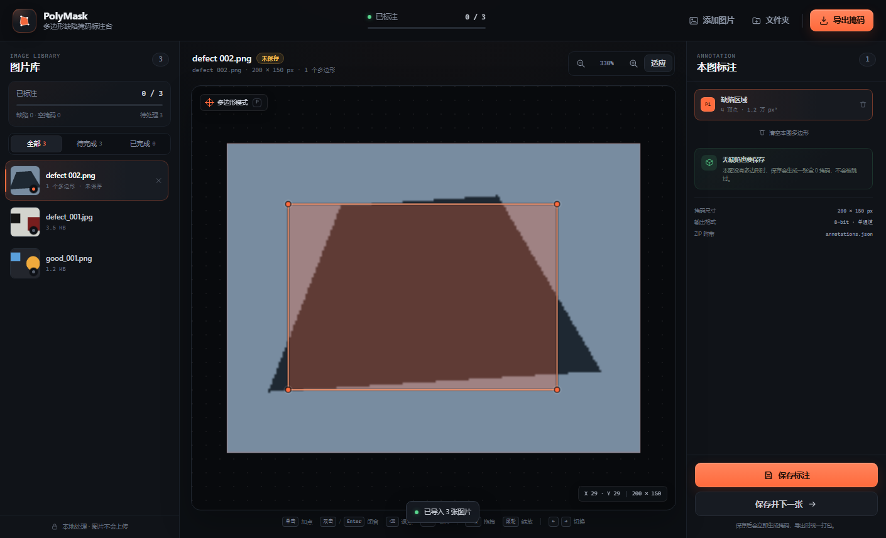

# PolyMask Studio

[在线 Demo](https://dingzhen-114514.github.io/polymask-studio/) · [使用流程](#使用流程) · [掩码规格](#掩码规格)

[](LICENSE)
[](#文件)

纯前端的多边形缺陷掩码标注台。导入工业/产品图片，逐张勾画缺陷轮廓，导出与原始图片同尺寸、同主文件名的 8-bit 单通道二值掩码 PNG。

无后端、无账号、无构建步骤、无第三方依赖。图片和标注全部留在浏览器内存中。



## 启动

直接双击 `index.html`，用 Chrome / Edge 打开即可。

如果浏览器对本地文件限制较多，也可以在项目目录启动一个静态服务器：

```powershell
python -m http.server 8765
```

然后访问 `http://127.0.0.1:8765/`。

推荐使用最新版 Chrome / Edge。文件夹导入依赖 `webkitdirectory`，部分浏览器可能不支持；此时可改用多选图片或拖拽文件夹。

## 部署

这是纯静态站点，没有构建步骤。把仓库根目录交给任意静态托管即可：

- **GitHub Pages**：仓库 `Settings → Pages → Build and deployment → Deploy from a branch`，选择 `main` 和 `/ (root)`。
- **Netlify / Vercel / Cloudflare Pages**：直接导入仓库，构建命令留空，输出目录填 `/`。
- **Nginx / Apache**：把整个目录作为站点根目录。

页面使用相对路径，部署在子路径下也可以正常工作。图片始终由访问者的浏览器读取和处理，不会上传到托管服务器。

## 使用流程

1. 点击「选择图片」或「选择文件夹」，也可以把图片/文件夹直接拖进页面。
2. 在左侧缩略图列表选择图片，用 `←` / `→` 切换上一张、下一张。
3. 默认处于多边形模式：在图片上单击添加顶点。
4. 双击、按 `Enter`，或点击起点闭合多边形。`Backspace` 退掉上一个顶点，`Escape` 取消当前草稿。
5. 闭合后拖动顶点可微调；右键点击顶点可删除该顶点；在右侧列表可选中或删除整条多边形。
6. 点击「保存标注」生成并缓存当前掩码；「保存并下一张」会保存后自动跳到下一张。
7. 全部处理完后点击「导出掩码」，浏览器会下载一个 ZIP。

一张图可以画多个独立多边形。没有缺陷的图片也请保存：会生成一张全 0 掩码，不会被跳过。

## 导出内容

ZIP 中包含：

- 每张原图对应的掩码 PNG；
- `annotations.json`，记录每张图的多边形顶点（图像像素坐标）与掩码元信息。

### 掩码规格

| 项目 | 规格 |
| --- | --- |
| 格式 | PNG，8-bit 灰度，单通道（color type 0） |
| 缺陷区域 | 255 |
| 背景 | 0 |
| 尺寸 | 与原图完全一致，不缩放、不裁剪 |
| 命名 | `{原图主文件名}.png`，例如 `defect_001.jpg` → `defect_001.png` |
| 无缺陷图片 | 全 0 掩码，仍然导出 |

多边形使用像素中心扫描线栅格化，只产生 0 和 255，不带抗锯齿灰度。PNG 由内置编码器生成，不经过 canvas 的 RGBA 编码。

### annotations.json 结构

```json
{
  "format": "polymask-annotations",
  "version": 1,
  "coordinateSystem": "image pixels, origin at top-left",
  "maskFormat": { "type": "8-bit grayscale PNG", "foreground": 255, "background": 0 },
  "images": [
    {
      "image": "batch/defect_001.jpg",
      "mask": "defect_001.png",
      "width": 320,
      "height": 240,
      "defectCount": 1,
      "polygons": [[[30, 30], [160, 30], [160, 120], [30, 120]]]
    }
  ]
}
```

坐标原点在左上角，单位是原图像素，不是 canvas 显示坐标。

## 行为说明

- 导入支持 JPG、PNG、WEBP、BMP、GIF、AVIF；文件夹会递归读取，最多 2000 张。
- 重复文件（路径 + 大小 + 修改时间相同）会自动忽略。
- 若不同子目录中有相同主文件名，导出时后出现的掩码会自动加 `_2`、`_3` 后缀避免覆盖；`annotations.json` 中的 `mask` 字段记录实际文件名。
- 导出时会为尚未保存的图片即时生成掩码，因此不必先逐张点保存。
- 刷新页面会丢失当前会话数据，这是预期行为；没有上传、云端保存或 AI 标注。
- 当前只支持多边形，不支持矩形、圆形、关键点等标注类型。

## 文件

- `index.html` — 页面结构与全部 UI 容器
- `styles.css` — 深色工业风样式与响应式布局
- `app.js` — 导入、视图、多边形编辑、栅格化、PNG/ZIP 编码、导出

`test-assets/` 中放了几张本地测试图，可直接用来试用。

## English

PolyMask Studio is a dependency-free, browser-only polygon annotation tool for industrial defect detection. It exports 8-bit single-channel PNG masks at the original image resolution, with `255` for defect pixels and `0` for background. Every image, including images without defects, gets a mask; all files are packaged into a ZIP together with `annotations.json`. Images never leave the browser.

## License

[MIT](LICENSE)
